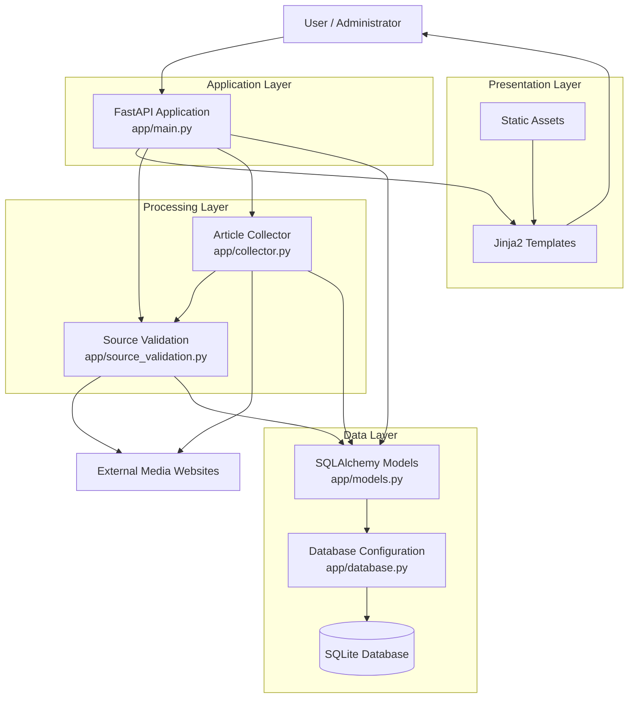
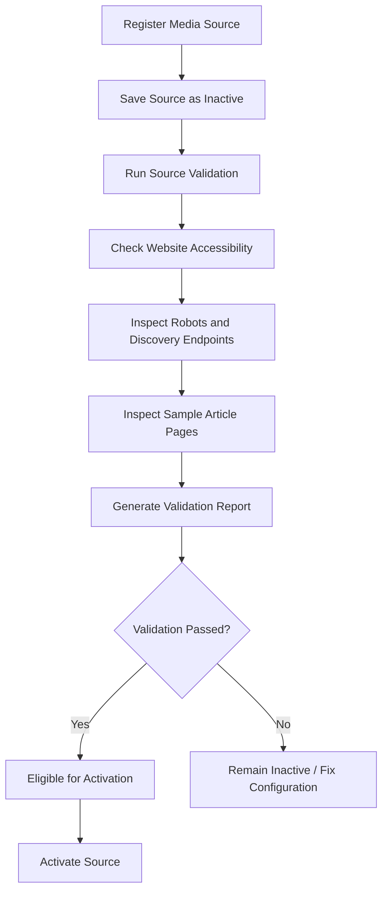
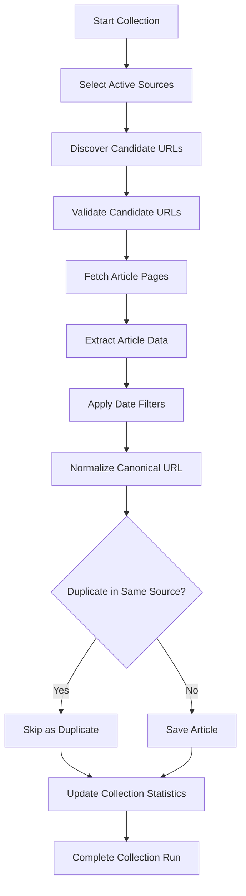

# System Architecture

## 1. Overview

GPR Media Intelligence is a local web-based application designed to support government public relations media intelligence activities.

The application provides a workflow for registering media sources, validating source accessibility and structure, collecting news articles, storing article records, and retrieving archived news through a web dashboard.

The current implementation uses a modular Python application architecture built around FastAPI, SQLAlchemy, and SQLite.

The application is currently intended for local use and development. It is not yet designed as a production multi-user platform.

## 2. Technology Stack

| Component | Technology | Responsibility |
|---|---|---|
| Programming language | Python 3.14.7 | Application logic |
| Web framework | FastAPI | HTTP routes and request handling |
| ASGI server | Uvicorn | Application server |
| Template engine | Jinja2 | Server-rendered HTML |
| ORM | SQLAlchemy | Database models and queries |
| Database | SQLite | Local persistent storage |
| HTTP client | HTTPX | External media requests |
| Feed parser | Feedparser | RSS/Atom feed parsing |
| Testing | Pytest | Automated testing |

## 3. High-Level Architecture

The application is organized into several logical layers:

1. Presentation layer — dashboard pages and HTML templates.
2. Application layer — FastAPI routes and request orchestration.
3. Collection and validation layer — media discovery, validation, and article extraction.
4. Data access layer — SQLAlchemy models and database sessions.
5. Storage layer — SQLite database and archived article records.

### Architecture Diagram

The diagram represents the logical responsibilities of the application. It does not imply that every module directly accesses every other module in all request flows.

## 4. Main Application Modules

### 4.1 `app/main.py`

The main application module.

Responsibilities include:
- Initializing the FastAPI application.
- Defining web routes and request handlers.
- Rendering dashboard pages.
- Handling media source management requests.
- Coordinating source validation.
- Starting article collection.
- Handling archive search, filtering, sorting, pagination, and article details.
- Coordinating database operations.

This module acts as the application orchestration layer.

### 4.2 `app/collector.py`

The article collection module.

Responsibilities include:
- Discovering candidate article URLs.
- Retrieving article pages.
- Extracting article metadata and content.
- Applying publication date filters.
- Checking existing records for duplicates.
- Saving eligible articles.
- Recording collection results and errors.

The collector supports available source discovery mechanisms, including sitemap and homepage fallback. RSS/Atom support is used where applicable.

Collection is source-aware and can be restricted to selected media source IDs.

### 4.3 `app/source_validation.py`

The source validation and outbound request safety module.

Responsibilities include:
- Checking whether a media website is accessible.
- Inspecting robots.txt.
- Discovering sitemap and feed endpoints.
- Inspecting sample article pages.
- Identifying article URL patterns.
- Evaluating title, content, author, and publication date extraction.
- Generating source validation reports.
- Applying URL and outbound request security checks.

Validation samples are read-only. They are not automatically inserted into the news archive.

### 4.4 `app/models.py`

Defines SQLAlchemy database models, including:
- `MediaSource`
- `NewsArticle`
- `CollectionRun`
- `SourceValidationRun`

### 4.5 `app/database.py`

Provides database configuration, SQLAlchemy engine/session setup, and database access infrastructure.

### 4.6 Templates and Static Assets

The `app/templates/` directory contains Jinja2 templates for dashboard pages.

The `app/static/` directory contains static assets such as CSS, JavaScript, and other frontend resources.

## 5. Main Application Workflows

### 5.1 Media Source Registration and Validation

A source must be validated before it becomes eligible for activation through the normal workflow.

Changing the source base URL invalidates its previous validation state and deactivates the source.

### 5.2 Article Collection

The actual workflow may include retry handling and additional checks depending on the source and collection configuration.

### 5.3 Archive Retrieval

The archive workflow retrieves stored articles from the database and supports:
- Keyword search.
- Media source filtering.
- Publication date filtering.
- Newest-first and oldest-first ordering.
- Pagination.
- Article detail display.
- Original source links.

Archive retrieval does not require recollecting the original article.

## 6. Data Flow

The main data flow is:

1. A user registers a media source.
2. The application stores the source configuration.
3. The validation module inspects the source.
4. Validation results and history are stored.
5. An eligible source is activated.
6. The user selects sources and a collection date range.
7. The collector discovers and retrieves article pages.
8. Article metadata is extracted and normalized.
9. Duplicate checks are performed within the same media source.
10. Eligible articles are stored in SQLite.
11. Collection run statistics are updated.
12. Users search and inspect archived articles through the dashboard.

## 7. Design Principles

### Modular Responsibilities
Collection, validation, database access, and web request handling should remain separated by responsibility.

### Source-Aware Collection
Collection behavior and duplicate detection must retain media source context.

### Archive Preservation
Application upgrades must preserve existing database records and archived articles.

### Configurable Sources
Source-specific validation configuration should be reusable for subsequent collection operations.

### Defensive External Requests
All outbound requests to media websites should follow URL validation, redirect validation, response size restrictions, and other security controls.

### Testability
Core collection and validation logic should remain testable independently of live external websites.

## 8. Current Limitations

The current implementation has the following limitations:

- The application is focused on local use.
- Collection depends on the accessibility and structure of external websites.
- Website layout changes may require source configuration updates.
- Not all websites expose RSS or sitemap endpoints.
- Some article content may be inaccessible or incomplete.
- Large-scale distributed collection is not yet implemented.
- Multi-user authentication and role-based authorization are not yet documented as implemented features.
- Advanced analytics, reporting, and AI-assisted analysis remain planned development areas.

## 9. Future Architecture Direction

Potential future improvements include:

- Dedicated background job processing.
- Scheduled collection.
- More comprehensive application-level logging and monitoring.
- API endpoints for external integrations.
- Advanced search and analytics services.
- Export and reporting modules.
- AI-assisted article classification and summarization.
- Multi-user authentication and authorization.

These improvements should preserve the current archive data model and source-scoped duplicate policy unless a deliberate migration is approved.
