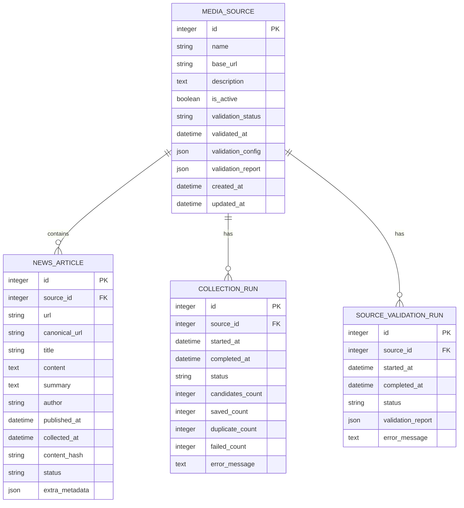

# Database Documentation

## 1. Overview

GPR Media Intelligence uses SQLite as its local relational database and SQLAlchemy as its Object Relational Mapper (ORM).

The database stores:
- Registered media sources.
- Archived news articles.
- Article collection execution history.
- Media source validation history.

The database configuration is managed through `app/database.py`, while the SQLAlchemy models are defined in `app/models.py`.

The default local database file is:

```text
data/news_archive.db
```

The database contains persistent application data and must be preserved during application upgrades.

## 2. Entity Relationship Diagram



The diagram illustrates the intended logical relationships. The exact column types, nullability, defaults, constraints, and relationship definitions must be checked against the current implementation in `app/models.py`.

## 3. Database Models

### 3.1 MediaSource

Represents a registered media website.

Main responsibilities:
- Store media source identity and base URL.
- Store source description.
- Control whether a source is active.
- Track validation status.
- Store reusable source validation configuration.
- Store the latest validation report.
- Track creation and update timestamps.

Important fields:

| Field | Purpose |
|---|---|
| `id` | Primary key |
| `name` | Media source name |
| `base_url` | Main website address |
| `description` | Optional source description |
| `is_active` | Source activation status |
| `validation_status` | Latest validation state |
| `validated_at` | Last successful validation timestamp |
| `validation_config` | Reusable source-specific extraction configuration |
| `validation_report` | Latest validation report |
| `created_at` | Record creation timestamp |
| `updated_at` | Last update timestamp |

A source must pass the required validation workflow before activation.

Changing its base URL invalidates its previous validation state and deactivates the source.

### 3.2 NewsArticle

Represents an archived news article collected from a media source.

Main responsibilities:
- Store article metadata.
- Store the original article URL.
- Store its normalized canonical URL.
- Store extracted article content and summary.
- Store author and publication date when available.
- Track collection time.
- Store a content hash.
- Store article status and additional metadata.

Important fields:

| Field | Purpose |
|---|---|
| `id` | Primary key |
| `source_id` | Reference to the originating media source |
| `url` | Original article URL |
| `canonical_url` | Normalized URL used for duplicate detection |
| `title` | Article title |
| `content` | Extracted article content |
| `summary` | Article summary, when available |
| `author` | Article author, when available |
| `published_at` | Original publication date, when available |
| `collected_at` | Time the article was collected |
| `content_hash` | Hash representing article content |
| `status` | Article processing or record status |
| `extra_metadata` | Additional extracted metadata |

The `source_id` field associates each article with its originating media source.

### 3.3 CollectionRun

Represents an article collection execution.

It records information about a collection process, including:
- Source association, where applicable.
- Collection start and completion timestamps.
- Execution status.
- Candidate URL count.
- Number of saved articles.
- Number of duplicates skipped.
- Number of failed operations.
- Error information.

Collection history helps users understand the outcome of previous collection operations.

### 3.4 SourceValidationRun

Represents one execution of media source validation.

It records:
- The media source being validated.
- Validation start and completion timestamps.
- Validation status.
- Validation report.
- Error information.

This model preserves validation history independently of the latest validation state stored on `MediaSource`.

## 4. Relationships

### MediaSource to NewsArticle
One media source can contain many archived news articles.

Each article belongs to its originating media source through `NewsArticle.source_id`.

### MediaSource to CollectionRun
One media source can have multiple collection runs over time.

### MediaSource to SourceValidationRun
One media source can have multiple validation runs over time.

These relationships allow the application to preserve source-specific collection and validation history.

## 5. Duplicate Detection Policy

Duplicate detection is source-scoped.

The application uses the combination of:

```text
(source_id, canonical_url)
```

as the duplicate identity.

The database should enforce this policy through a composite uniqueness constraint or unique index.

### Accepted and Rejected Records

| Scenario | Result | Reason |
|---|---|---|
| Same canonical URL from the same media source | Rejected as duplicate | Same source and same normalized URL |
| Different URL from the same media source, same title | Accepted | Different article URL |
| Different URL from the same media source, similar content | Accepted | Content similarity is not a rejection condition |
| Same article URL from different media sources | Accepted | Different source identity |
| Similar article content from different media sources | Accepted | Different source identity |

### Important Rule

The application must not use `content_hash` as a condition for rejecting an article.

`content_hash` is retained for future analysis, content comparison, and integrity-related use.

It does not replace source-scoped canonical URL duplicate detection.

## 6. Indexing and Constraints

The following database design rules must be maintained:

- Primary keys identify individual records.
- `NewsArticle.source_id` references its originating media source.
- The article duplicate constraint must be composite and source-scoped.
- The duplicate constraint must not be global on `canonical_url`.
- Existing archive records must remain intact during schema upgrades.

Additional indexes may be introduced for frequently used search and filtering fields, subject to performance testing.

## 7. Database Initialization

The application initializes its database infrastructure through `app/database.py`.

The application currently uses SQLAlchemy metadata creation for initial table setup.

The existing database must not be deleted or recreated simply to apply application changes.

For future schema modifications, use a controlled migration process. A migration should:
1. Identify the current database schema.
2. Back up the database.
3. Apply the smallest necessary schema change.
4. Preserve all existing records.
5. Verify constraints and relationships.
6. Run the automated test suite.
7. Confirm that existing archived articles remain accessible.

A migration should be tested against a copy of the production or development database before being applied to the primary archive.

## 8. Backup and Data Preservation

The SQLite database contains the application's persistent archive.

Recommended practices:
- Back up `data/news_archive.db` before schema changes.
- Keep backups outside the Git repository.
- Do not commit database files to a public repository.
- Do not delete existing archive data during routine updates.
- Verify record counts before and after migrations.
- Test database recovery procedures periodically.

## 9. Database Access Rules

Database access should use the SQLAlchemy infrastructure defined by the project.

Application modules should avoid introducing unrelated direct SQLite connections.

Database queries should:
- Use parameterized ORM operations.
- Preserve source relationships.
- Handle missing or nullable publication dates safely.
- Avoid destructive operations unless explicitly required.
- Keep transaction boundaries clear.

## 10. Future Improvements

Potential database improvements include:
- A formal migration framework.
- Additional indexes for archive search.
- More detailed collection metrics.
- Expanded article classification metadata.
- Full-text search support.
- Analytics-oriented data structures.
- Improved retention and backup management.

Any future database changes must preserve the established source-scoped duplicate policy and existing archive records.
